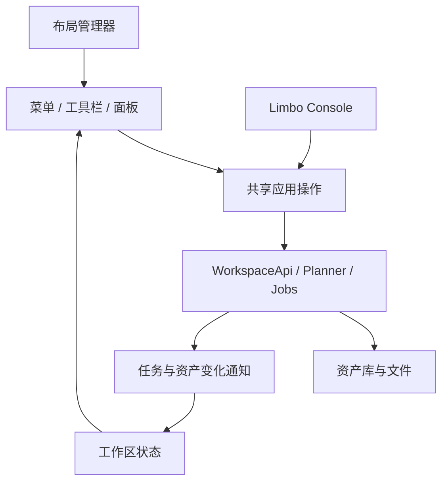

# Animanager Interface 规划

版本：0.1 · 状态：规划草案 · 日期：2026-11-14  
适用基线：Animanager 0.3 / Godot 4.7.2 Mono / Limbo Console 0.8.0

实施记录（2026-11-14）：0.4 已开始落实工作区、统一控件、小窗口和 DPI 基础。实际交付范围与验证边界见 [WORKSPACE.md](WORKSPACE.md)。本文保留完整规划，不代表全部规划功能已经完成。

## 1. 目标与范围

将现有原型界面升级为适合长期使用的桌面资产工具。界面的成熟度由布局、操作一致性、状态反馈和设备适配共同决定，不能仅靠更换颜色和图标。

本轮规划落实三个要求：

| 用户要求 | 产品定义 | 完成依据 |
| --- | --- | --- |
| 参考成熟现代软件 | 有清楚的工作区、工具栏、属性面板、任务中心，以及一致的控件与交互规范 | 核心工作流无需记控制台命令；同类操作行为一致 |
| 页面可拖拽调整 | 面板可调整尺寸、移动停靠、组成标签组、隐藏、最大化，并保存布局 | 调整后重启可恢复；缩小窗口或切换屏幕仍可用 |
| 按 App 标准制作 Control | 按可用空间重排，正确处理 DPI、文字、焦点、输入和弹窗 | 通过明确的窗口尺寸、缩放、多屏与输入验收矩阵 |

本轮交付的是设计与实施规划。界面改造沿用现有 Godot / C#，保留 Limbo Console 和已有资产、预览、任务能力。

**范围假设：**第一验收平台为 Windows 桌面，包括笔记本、外接显示器、高 DPI 和多显示器；设计为 macOS / Linux 留出字体、快捷键和窗口行为适配位置。触摸设备采用更大的交互目标；手机端与独立移动应用需要另外定义工作流，不作为本轮已承诺的支持平台。

本轮不引入 Unreal 集成、重定向、云同步或动画编辑等新业务能力。后文涉及尚未实现的操作时，会标明依赖；界面不提供没有后端能力的可点击入口。

## 2. 参考方向

以下是已查阅的官方交互参考。借鉴的是可解释的行为，Animanager 的默认布局、尺寸和视觉规范由本规划独立定义。

| 参考软件 | 官方资料中的相关能力 | Animanager 的取舍 |
| --- | --- | --- |
| Adobe Bridge | 资产内容、预览、元数据等面板；保存和切换工作区；拖入边缘停靠、拖入中间分组 | 参考资产浏览与属性检查的关系，以及明确的停靠落点。[工作区](https://helpx.adobe.com/uk/bridge/desktop/workspaces-and-panels/customize-the-workspace.html)、[面板调整](https://helpx.adobe.com/bridge/desktop/workspaces-and-panels/adjust-panels.html) |
| VS Code | 侧栏、底部面板、标签分组、移动视图、恢复默认位置与布局记忆 | 参考任务 / 日志区域、面板恢复入口、键盘移动面板，以及布局与内容状态的分离。[Custom Layout](https://code.visualstudio.com/docs/configure/custom-layout) |
| Blender | 拖动区域边界改变尺寸、区域最大化与恢复 | 参考 3D 预览的专注模式与尺寸调整；Animanager 使用可见面板标题和落点提示来移动面板。[Areas](https://docs.blender.org/manual/en/latest/interface/window_system/areas.html) |

建议方向：**中性深色、紧凑但可读的桌面工作区。** 内容区域承担视觉重点，导航和工具保持克制；列表、属性和任务记录保持较高信息密度。实际资产名称、文件类型、任务状态作为主要内容。

## 3. 当前界面审视

依据当前 `UI/MainShell.cs`、`UI/StudioTheme.cs`、`UI/Components/Preview3DViewport.cs` 与 `project.godot`：

| 现状 | 影响 | 改造方向 |
| --- | --- | --- |
| 已采用 Container 与 HSplitContainer | 有基础自适应和横向尺寸调整能力，可继续利用 | 增加工作区管理、面板独立性与尺寸约束 |
| 窗口最小尺寸写为 1120×840，初始尺寸 1440×900 | 小屏、高缩放和扣除任务栏后的可用高度可能不足 | 根据屏幕可用区域初始化；按有效内容尺寸重排 |
| 分类、列表、预览、详情和导出长期同时显示 | 内容相互挤占，预览与操作区容易过小 | 将预览、属性、导出、任务拆分为可组合面板 |
| 控件字号、间距和尺寸分散在构建代码中 | 很难统一密度和缩放，容易遗漏控件状态 | 集中主题 token 与可复用控件 |
| 主界面构建和业务回调集中在 MainShell | 布局变化容易牵动选择、预览和任务逻辑 | 分离工作区状态、命令绑定和视图 |
| Console 有任务队列，现有按钮仍有独立导入 / 导出路径 | 不同入口的状态和行为可能不一致 | GUI 和 Console 逐步统一到相同应用操作与任务记录 |
| 缺少布局持久化、停靠和完整适配测试 | 暂时不能宣称跨设备显示可靠 | 将适配矩阵与布局恢复列为发布门槛 |

## 4. 信息架构与默认工作区

### 4.1 页面结构

主界面是一个持续工作的工作区。导入、预览、导出、任务查询都在这个工作区中完成。

```text
┌───────────────────────────────────────────────────────────────────────┐
│ 系统标题栏：Animanager · 当前资产库                                    │
├───────────────────────────────────────────────────────────────────────┤
│ 文件   视图   工作区   工具   帮助       导入   导出所选   布局   设置 │
├─────────────┬───────────────────────────────┬─────────────────────────┤
│ 资源导航    │ 资产                          │ 预览                    │
│             │ 搜索 / 筛选 / 排序 / 视图     │                         │
│ 全部资产    │                               │       3D 视口           │
│ 动画        │ 名称      类型   标签   大小  │                         │
│ 模型        │ ...                           │ 片段 / 播放 / 时间轴    │
│ 收藏        │                               ├─────────────────────────┤
│             │                               │ 属性  |  导出           │
│ 标签筛选    │                               │ 当前选择的详情或配置    │
├─────────────┴───────────────────────────────┴─────────────────────────┤
│ 任务  |  日志                                      展开 / 收起        │
├───────────────────────────────────────────────────────────────────────┤
│ 资产数 / 已选数量                后台任务摘要              Console F12 │
└───────────────────────────────────────────────────────────────────────┘
```

此图表达区域关系，不是固定像素稿。右侧预览与属性之间、主要列之间、底部任务区上缘均可调节。任务区默认收起或保持一行摘要，用户开始任务后不强制打开并遮挡预览。

### 4.2 面板职责

| 面板 | 内容与边界 |
| --- | --- |
| 资源导航 | 全部、动画、模型、收藏和标签筛选；当前库只有虚拟路径索引，不能伪装成已实现的源文件夹同步树 |
| 资产浏览 | 默认详情列表；搜索、排序、筛选、单选和多选。只显示已知字段；未分析的时长 / 骨架信息显示“未分析” |
| 预览 | 模型、相机、片段选择和播放控制；时间轴始终属于该预览，不控制其他任务或选择 |
| 属性 | 名称、格式、大小、库位置、标签与收藏；多选时显示选中数量和已支持的共同操作 |
| 导出 | 选择范围、输出格式、目录、计划摘要和执行入口；名称必须明确“导出所选 12 项”等操作对象 |
| 任务 | 排队、运行、成功、部分失败、已取消、中断等状态；展开后查看每项结果、取消和重试 |
| 日志 | 所选任务 / 文件的诊断内容、复制与定位日志文件；用户向上滚动后暂停自动跟随，提供“回到最新” |
| Limbo Console | 保留现有 F12 入口与命令；首版保持独立覆盖层，单独适配尺寸和焦点，关闭后回到之前面板 |

有缩略图缓存后再增加正式网格视图。第一阶段使用明确的文件类型图标，不给每个列表条目创建实时 3D 视口。

### 4.3 预设工作区

- **浏览**：资产列表占主要空间，预览和属性在右侧。
- **预览**：预览占主要空间，资产列表缩窄，属性可收起。
- **批处理**：资产选择、导出计划与任务列表同时可见。

切换预设只改变布局；不重启任务、不重新入库、不清空搜索。预览状态和当前选择保留。用户可另存命名布局，始终提供“恢复默认布局”和“显示隐藏面板”。

## 5. 拖拽与布局规范

### 5.1 本轮界面完成所需的拖拽能力

| 操作 | 交互要求 |
| --- | --- |
| 调整宽高 | 拖动分隔线；悬停显示方向光标和高亮；命中区域建议至少 8 个逻辑单位，视觉线可更细 |
| 移动面板 | 拖动面板标题或标签；面板正文中的文字选择、列表选择、视口操作不会触发布局拖动 |
| 停靠 | 拖到目标边缘预览上下 / 左右分区，拖到中央预览加入标签组；释放前显示完整落点 |
| 标签排序 | 同组标签可拖动排序；拖到另一组可移动，不复制面板实例 |
| 隐藏与恢复 | 关闭面板表示隐藏视图，后台数据与任务继续存在；通过“视图”菜单可找回 |
| 最大化 | 标题操作菜单可最大化当前面板，再次执行精确恢复之前布局 |
| 取消拖动 | Esc 或放到无效位置恢复原布局；失去焦点时不留下悬空的拖动预览 |
| 键盘替代 | 面板菜单提供“移动到左 / 右 / 下 / 标签组”等操作；不能要求所有用户必须拖鼠标 |

面板内容空间不足时，优先合并为标签组或收起辅助面板。不能把面板压缩到零宽而让用户无法找回。禁止把所有可操作的主要区域都隐藏；至少保留一个内容面板以及全局恢复入口。

**浮动窗口与跨窗口拖动属于后续增强。** 第一轮界面里程碑必须完成单主窗口内的停靠、标签分组和布局恢复；仅实现分隔栏拉伸不能算完成拖拽要求。主窗口在不同 DPI 显示器之间移动的正确适配属于第一轮验收。

### 5.2 保存与恢复

- 面板使用稳定 ID，保存分割树、组内顺序、可见性、活动标签和分割比例。
- 比例用于表达偏好；恢复时重新应用各面板最小尺寸和当前可用空间，避免照搬上一块屏幕的绝对坐标。
- 保存时机为拖动结束、切换工作区及关闭窗口，使用短暂防抖和原子写入，避免每个鼠标移动事件都写磁盘。
- 持久化包含 schema 版本。未知面板 ID 忽略，损坏配置退回默认布局并提示可恢复；布局错误不能阻止应用启动。
- 区分“用户保存的布局”和“当前小窗口的临时适配结果”。窗口变小引起的临时合并不覆盖用户的大屏偏好。
- 窗口尺寸与位置单独保存，启动时与当前屏幕可用区域求交；外接屏断开后恢复到可见屏幕。
- 布局变化不销毁当前资产加载结果；至少保持选中 ID、筛选条件、滚动锚点、相机和播放位置。

### 5.3 资产拖放与布局拖放分开

文件 / 文件夹从系统拖入：显示导入落点和扫描反馈，进入现有批量导入流程。拖入期间不把面板重新停靠。

内部资产拖入预览：加载资产。内部资产拖入导出面板：更新待导出选择并显示数量，不立即开始写文件。拖放失败或不支持时给出明确反馈。

## 6. 屏幕、窗口与 DPI 适配

### 6.1 尺寸定义

本文控件尺寸均为 **逻辑 UI 单位（LU）**。断点使用扣除系统装饰后的内容区有效尺寸，不能直接用显示器的物理分辨率判断布局。

建议第一轮完整可操作的内容区下限为 **720×400 LU**，推荐工作区为 **1280×720 LU 及以上**。下限是设计目标，需要通过验收；不是把固定最小窗口直接写成 720×400 物理像素。低于下限时使用单面板与局部滚动作为兜底，并保留布局恢复和缩放设置入口，不保证多个面板同时显示。

### 6.2 布局模式

以下断点是第一版原型的初始值，实施时依据内容最小尺寸校准。高度约束比宽度模式更优先。

| 有效内容宽度 / 高度 | 布局行为 |
| --- | --- |
| 宽 ≥1440 LU，且高 ≥700 LU | 展开导航、资产、右侧预览 / 属性；允许常驻任务面板 |
| 宽 1100–1439 LU | 优先资产与预览两大区域；导航可折叠；属性与导出用标签；任务默认收起 |
| 宽 800–1099 LU | 导航转为可收起入口；资产和预览可切成主区域标签，属性按需显示 |
| 宽 <800 LU，或高 <500 LU | 单主面板模式：资产 / 预览 / 属性 / 任务切换；搜索和关键操作保留，次要工具进入更多菜单 |
| 高 500–699 LU | 不同时展开过多上下分区；属性用滚动区，任务按需切换，播放控件可换行 |

模式切换保留当前焦点所处内容；输入法组字或面板拖动期间延迟重排。断点附近增加滞回，避免用户拖窗口时反复跳动。

“正常显示”的含义是关键功能可到达、内容可读、操作可完成，不要求小屏同时显示所有面板。

### 6.3 缩放策略

Godot 官方对非游戏应用建议使用 `disabled` stretch mode，并通过内容缩放适配高 DPI；本项目据此采用“容器重排 + 统一 UI 缩放”的方向。[Multiple resolutions / Non-game application](https://docs.godotengine.org/en/stable/tutorials/rendering/multiple_resolutions.html#non-game-application)

- 设置提供“跟随系统”和手动 100%、125%、150%、175%、200%。手动值表示应用最终 UI 比例，不能在已生效的系统比例上无意再乘一次。
- 字号、图标、间距、分隔栏命中范围和弹出菜单一起缩放；缩放后重新计算布局模式。
- 3D 预览分辨率与 UI 缩放分离，不能通过降低整窗分辨率让文字模糊。
- 字体与图标在目标比例下清晰渲染；首版检查 125% / 150% 的文字裁切、线条与鼠标命中。
- 跨屏后更新本窗口缩放和可用区域；菜单与对话框使用所属窗口的缩放，避免主窗和弹窗大小不一致。
- 不能仅凭屏幕分辨率猜测 DPI。Godot 显示缩放 API 在不同平台 / 版本存在差异，实施前先验证本机 4.7.2 Mono 的实际返回和跨屏事件；读不到可靠系统值时保留手动缩放并说明回退。[DisplayServer](https://docs.godotengine.org/en/4.5/classes/class_displayserver.html#class-displayserver-method-screen-get-scale)

### 6.4 溢出和长内容

- 主窗口整体不出现横向滚动条；详情表格可以局部横向滚动，属性与日志可以局部纵向滚动。
- 长名称单行省略并可查看完整文本；文件路径优先保留末尾文件名，提供复制完整路径。
- 工具栏有确定的溢出顺序：先隐藏辅助说明，再把次要动作移入更多菜单，保留主动作及可识别标签。
- 文本输入不会因按钮被挤出而无法提交；标签编辑、导出路径和错误消息都需要窄窗口样例。
- 对话框高度限制在可用区域内；内容滚动，底部确认 / 取消操作可到达。原生文件选择器沿用操作系统行为。

## 7. 控件与视觉规范

### 7.1 基础 token 建议

这些是可实施的起点，最终颜色与密度需在真实窗口中校验。

| 类别 | 建议 |
| --- | --- |
| 背景层次 | 工作区 `#20242A`，面板 `#272C33`，浮层 `#303741`；使用边界和轻微明度差区分区域 |
| 文字 | 主文字 `#E8ECF1`，次文字 `#AAB4C0`；日志和时间数字用易区分字符的等宽字体 |
| 强调色 | `#8CC8B8` 用于选中、焦点和主操作；错误 / 警告色只承担状态含义 |
| 字体 | 正文 14 LU，表格 13–14 LU，面板标题 14 LU 中等字重；辅助文字不低于 12 LU |
| 字体覆盖 | 优先可靠的桌面 UI 字体，明确中文 fallback；独立发行评估随包字体及许可，不能只依赖开发机的 Microsoft YaHei |
| 间距 | 4 / 8 / 12 / 16 / 24 LU；主工作区外边距约 8 LU，避免装饰性大留白挤占列表和预览 |
| 控件密度 | 标准输入 / 按钮高约 32 LU，紧凑模式约 28 LU；触摸友好模式目标 ≥44 LU 命中范围 |
| 图标 | 一套统一风格，常用 16 / 20 LU；可缩放资源；图标按钮必须有名称和提示 |
| 圆角与边界 | 常规控件 4–6 LU；主要依靠分隔线和背景层次，不给每个区域叠加厚阴影 |
| 动效 | 焦点 / 状态反馈约 80–120 ms，可减少动效；尺寸拖动跟随指针，任务开始不触发整页入场动画 |

正文对比度目标至少 4.5:1，状态不能仅靠颜色区分。此处借用 WCAG 的可读性目标，不代表已经通过完整可访问性认证。[WCAG 2.2：对比度与颜色使用](https://www.w3.org/TR/WCAG22/#contrast-minimum)

### 7.2 每种 Control 的行为契约

| 控件 | 必须具备的行为 |
| --- | --- |
| Button / ToolButton | normal、hover、pressed、focus、disabled、busy 状态；禁用时说明原因；执行中的提交操作避免重复入队 |
| LineEdit / 搜索框 | 中文输入法、复制粘贴、选中、清空、占位文字、错误状态；不在输入法组字阶段发起搜索；查找结果变化不抢焦点 |
| 路径选择器 | 输入与浏览两种入口；完整路径可复制；提交前校验并在字段旁显示错误 |
| 资产列表 | Shift 连选、Ctrl 多选、键盘上下移动、Ctrl+A 选择范围明确；多选数量和当前主项清楚可见 |
| 下拉框 / 菜单 | 键盘导航、当前值、禁用原因、屏幕边缘避让；菜单项目过多时可滚动 |
| 属性表单 | 标签与输入对齐；窄模式转纵向；修改状态明确，支持保存 / 放弃；没有后端批量编辑时不显示批量保存按钮 |
| 时间轴 | 拖动与数值定位一致，播放 / 暂停状态清楚；无动画时禁用并说明；窄模式仍能播放和定位 |
| 分隔栏 / 面板标签 | 清楚的命中、拖动反馈、落点与取消；支持键盘替代操作 |
| 任务行 | 已处理数量与成功 / 失败 / 跳过 / 取消分开；“3/3 已处理”不能被渲染为“全部成功” |
| 对话框 / 浮层 | 打开后焦点进入，关闭后返回发起者；Esc 规则明确；错误后保留输入，确认操作可再次执行 |

列表“全选”首版默认指当前可见结果页；跨全部搜索结果操作必须明确标为“选择全部 N 个匹配项”，并固定资产 ID 快照。列表刷新不能悄悄扩大已确认的导出范围。

### 7.3 键盘、焦点与输入设备

- Ctrl+F 搜索，F12 开关 Console，F6 在主要面板间切换；其他快捷键在命令注册表统一定义，并显示在菜单中。
- 空格播放只在预览上下文且没有文字输入焦点时生效。输入路径、中文组字、菜单打开时，不触发预览或全局操作。
- 面板最大化使用显式按钮 / 菜单；不默认占用 Ctrl+Space 等常见中文输入法快捷键。
- Tab / Shift+Tab 遵循视觉顺序；所有可操作控件有清楚的键盘焦点。隐藏面板不能继续接收快捷键。
- F12 打开 Console 时暂停其他工作区快捷键路由；关闭后恢复先前有效焦点。升级后沿用 Limbo 的历史和补全能力。
- 鼠标与触控板均可完成浏览；预览提供缩放、适配视图和操作提示，不能把中键作为唯一的平移入口。
- 为控件设置可访问名称、描述和状态；屏幕阅读器能力必须在导出后的应用中实测，不能仅凭视觉可用就宣称支持。

## 8. 核心流程与状态设计

### 8.1 浏览与预览

选择资产 → 显示已知元数据 → 预览加载状态 → 进入可播放状态。

快速切换选择时，过期加载结果不能覆盖最新选择；相机重置和缩放策略一致。多选时显示主项预览及“另选 N 项”标识，导出范围按明确的选择集合处理。未知骨骼数显示“未分析”，不显示误导性的 0。

### 8.2 导入

点击导入或拖入文件 → 扫描反馈 → 显示支持项 / 忽略项 / 扫描错误 → 入队 → 在任务中心查看结果。

大量文件、部分失败、重复跳过都保留可检查的结果。是否在扫描后自动入队由入口明确决定：普通导入沿用当前行为；“检查导入清单”提供先检查后执行的路径。

### 8.3 导出

选择资产 → 打开导出面板 → 确认格式、目录和范围 → 生成计划 → 查看数量与同名处理策略 → 执行 → 任务中心查看实际输出。

- GUI 和 Console 使用同一任务 ID、状态和报告。
- 一次只有一个明确的主提交按钮；计划变更后必须重新生成，不能执行旧范围而展示新范围。
- 目前批量只支持 FBX。多选时 GLB / RES 显示具体限制；单项 GLB / RES 必须确保导出的加载资产与所选资产一致。
- 目录不存在、目录不可写、Blender 未配置、无可用动画等情况要有具体提示和处理入口。
- 成功后可打开输出目录；部分失败时可查看失败项并重试，成功项不会再次导出。

### 8.4 通用状态

| 状态 | 表现 |
| --- | --- |
| 空库 | 简短说明与导入入口；内置基准资产作为可选辅助入口 |
| 无搜索结果 | 保留查询条件，提供清除筛选；不显示“库为空” |
| 扫描 / 加载 | 显示当前动作与可取消性；未知总量使用不定进度，不编造百分比 |
| 部分失败 | 保留成功结果，明确失败数量，提供详细信息和重试 |
| 无效资产 | 资产仍可检查和定位；预览区显示原因，不阻塞其他资产操作 |
| 崩溃后恢复 | 任务中心显示 Interrupted；引导检查输出并重试，沿用已有持久化语义 |
| 关闭主窗口且有任务 | 明确告知是否取消未完成任务，允许返回继续工作；隐藏任务面板不触发取消 |

## 9. Godot 实现结构

### 9.1 布局与视图

使用 Container 管理尺寸和重排。Godot 的容器会接管子 Control 的位置；布局实现不同时手工修改这些子控件的位置。[Using Containers](https://docs.godotengine.org/en/stable/tutorials/ui/gui_containers.html)

建议拆分结构：

```text
UI/
  Shell/          AppShell、菜单、工具栏、状态栏
  Workspace/      DockHost、DockGroup、PanelRegistry、布局恢复
  Panels/         Navigation、AssetBrowser、Preview、Inspector、Export、Jobs
  Controls/       PathPicker、SearchField、StatusBadge、EmptyState 等
  Theme/          颜色、字体、密度、间距、状态样式
  State/          选择、活动资产、筛选、布局、面板可见性
```

分割尺寸可基于 HSplitContainer / VSplitContainer，标签组基于 TabContainer。面板跨组移动、落点提示、持久化和响应式恢复需要工作区层处理，不能把 SplitContainer 当作完整 docking 框架。[SplitContainer](https://docs.godotengine.org/en/stable/classes/class_splitcontainer.html)

实施开始先用两个空面板验证停靠技术路径：检查 Godot 4.7.2 的实际 API，比较原生组合与维护中的第三方 docking 组件。选型标准为运行时可用、键盘控制、DPI、最小尺寸、布局序列化、许可和维护情况。没有完成验证前不在规划里绑定某个插件。

### 9.2 状态与业务边界



这表示目标结构；现有预览仍依赖 Godot 节点，需要通过明确的预览服务边界逐步解耦。

- 主选择集合、主项 ID 与预览当前加载 ID 分别保存，避免列表多选影响正在执行的任务。
- GUI 多选导出需要补充按明确资产 ID 集合创建计划的入口，不能把列表选择临时转换成模糊搜索字符串。
- 多入口共享启用条件、执行操作和错误返回。界面不复制一份导入 / FBX 导出逻辑。
- 任务进度从现有队列映射到视图，跨线程消息在主线程更新 Control。
- 主题与显示比例集中管理；面板不自行乘缩放系数。
- 布局配置与资产数据库分开存放；重置布局不触碰资产与历史任务。
- 当前原型 UI 的导入 / 导出按钮需在迁移时接入共同路径；不能只给旧按钮换皮肤。

### 9.3 性能要求

- 保留低处理器占用和按需预览重绘。隐藏预览面板时停止无意义渲染，重新显示时更新画面。
- 列表采用分页或虚拟化，不一次构建整个库的 Control。切换布局不重复扫描数据库和重载模型。
- 调整分隔栏时不写磁盘、不重新解码模型；预览尺寸更新按帧合并。
- 日志设置显示上限，完整内容继续落盘；持续任务输出不能使界面无限增高或占用内存。
- 第一轮先记录参考机器的空闲 CPU、布局拖动帧耗时、列表查询和加载时间，形成基线；不以截图流畅替代性能测量。

## 10. 分阶段实施与交付

| 阶段 | 交付内容 | 通过条件 |
| --- | --- | --- |
| I0 · 设计与技术验证 | 三种布局线框；主要控件状态页；DPI、中文输入和 docking 小样；明确 token 与平台回退 | 在宽屏和小窗口解释清楚全部关键动作；确认实际引擎技术路径 |
| I1 · 应用壳与基础控件 | 新工作区结构、菜单 / 工具栏 / 状态栏、统一主题、字段和列表控件、容器重排与分隔拖动 | 小样在 720×400 LU 的控件和导航可到达；支持手动缩放；无文本溢出和失焦操作 |
| I2 · 可定制工作区 | 面板停靠、标签分组、隐藏 / 恢复、最大化、预设与用户布局持久化 | 完成单窗口拖拽要求；重启、窄窗往返、异常配置恢复通过 |
| I3 · 业务接入与完整状态 | 浏览、预览、导入、导出计划、任务、日志和 Console 接入共享状态 | 不用 Console 也能完成已有的主要流程；Console 修改能同步反映到 GUI |
| I4 · 适配验收 | 分辨率 / DPI / 多屏 / 长文本 / 键盘 / 输入法验证；功能与性能回归 | 下方必测项通过后，才称为第一版成熟界面 |

I1 是布局骨架里程碑，I2–I4 完成后才满足本轮完整目标。后续增强可以加入浮动窗口、跨窗口面板拖动、正式缩略图网格、浅色主题和其他操作系统的完整验收。

## 11. 验收矩阵

所有尺寸都记录物理分辨率、系统比例、应用比例和实际内容区 LU。模拟窗口可以覆盖布局，但不能替代真实 DPI 切换、输入法和多显示器验证。缺少硬件的平台标为“未验证”，不能写成已通过。

### 11.1 显示场景

| 场景 | 必测组合 |
| --- | --- |
| 小屏笔记本 | 1366×768，系统 100% / 125% / 150%；窗口最大化和非最大化 |
| 常规显示器 | 1920×1080，100% / 125% / 150%；半屏使用 |
| 高 DPI 桌面 | 2560×1440，125% / 150%；3840×2160，150% / 200% |
| 宽屏与竖屏 | 3440×1440 横向；1080×1920 竖向；保持工具与属性合理宽度 |
| 极限内容区 | 720×400、800×500、1024×600 LU；低于下限的兜底操作 |
| 手动应用缩放 | 100% 到 200% 各档；确认没有双重缩放，布局随有效空间变化 |
| 混合 DPI 多屏 | 主窗从 100% 屏移动到 150% / 200% 屏，再移回；同时检查菜单、Console 和对话框 |
| 屏幕变化 | 外接屏断开、主屏变更、休眠恢复、从旧窗口位置重新启动 |

### 11.2 内容与交互

- 空库、无结果、1 个资产、跨页结果、大量长名称和中文路径。
- 无动画、单片段、多片段、损坏资产、缺失库文件、未配置 Blender。
- 导入时拖动布局、预览播放时缩放窗口、后台导出时关闭任务面板。
- 多选跨页后的范围说明、清除筛选、重新搜索、选择主项与预览一致性。
- 中文 IME、键盘全流程、触控板、200% UI 下的弹出菜单和字段错误。
- 部分失败、取消排队任务、取消运行任务、失败重试、重启后 Interrupted。
- 用户拖乱布局、配置缺失 / 损坏、隐藏所有辅助面板、恢复默认布局。

### 11.3 明确通过标准

1. 支持范围内没有无法到达的主操作、重叠文字、被裁掉的输入内容或屏幕外弹窗。
2. 控件尺寸、字体和鼠标命中一致；中文输入不会误触播放、导出或布局快捷键。
3. 面板可以调整、移动、恢复；布局调整不丢当前选择，不中断后台任务。
4. UI 与 Console 对同一操作显示相同任务和实际结果；“完成”与“全部成功”语义准确。
5. 现有 72 项功能测试继续通过；增加布局恢复、焦点、操作范围和关键状态转换测试。
6. 保存宽屏、常规、窄屏、高 DPI 四类真实窗口截图，以及拖动 / 跨屏操作记录；截图中的内容使用真实资产和任务结果。
7. 用户能够用 GUI 完成“导入 → 查找 → 预览 → 生成导出计划 → 执行 → 检查失败并重试”，布局与缩放设置始终可到达。

## 12. 当前建议与后续设计输出

当前建议采用 **可停靠的桌面工作区 + 中性深色控件体系 + 按有效空间重排**，先建立尺寸、输入和状态规范，再完成外观细节。

下一步设计输出应包含：

1. 浏览、预览、批处理三种工作区的低保真布局，分别覆盖宽屏与窄屏。
2. 搜索框、资产行、面板标题、导出表单、任务行和错误提示的完整状态样例。
3. 可运行的布局技术小样：拖动、分组、恢复、DPI 和中文输入，暂不迁移全部业务。
4. 一份实际验收记录，区分设计目标、自动化通过项与仍需真实设备验证的项目。

本文中的断点、配色和尺寸为第一版建议值；实施中可以按实测调整，但调整后仍需满足上述操作与适配验收条件。
