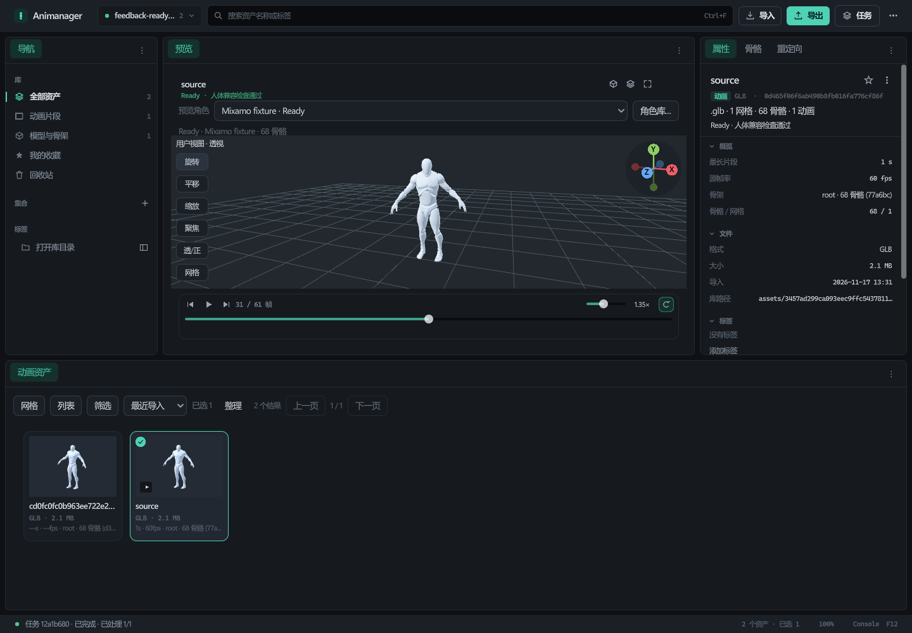
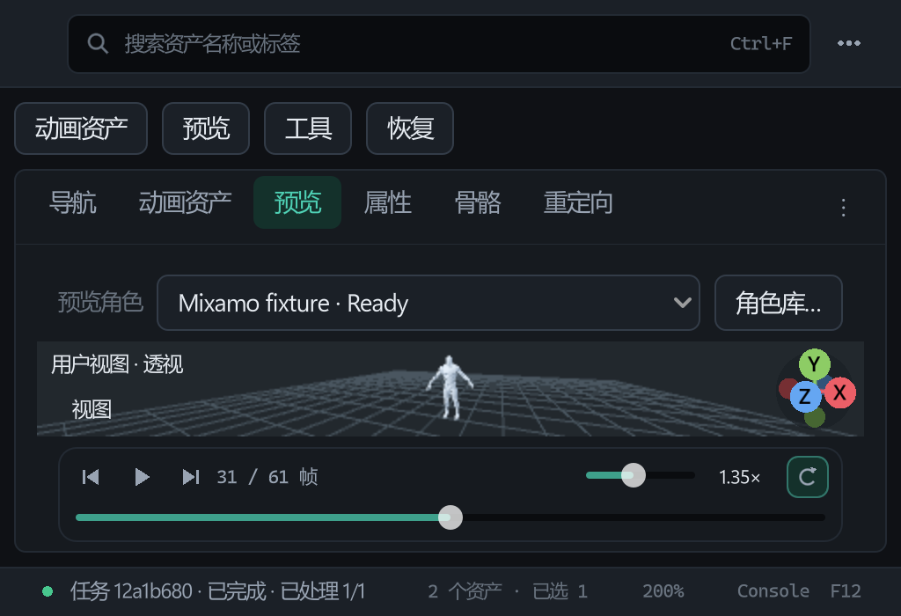

# 第一轮反馈验收 · 2026-11-17

Godot 4.7.2 Mono / .NET 8；构建零警告、零错误。保留原有工作区改动，未修改源动画或用户模型。

| 验证 | 结果 | 记录 |
| --- | --- | --- |
| 本轮专项（含图形输入） | 40 项通过 | `.runtime/feedback-ready-final.log` |
| UE4/UE5 重定向与真实 FBX 往返 | 75 项通过 | `.runtime/feedback-retarget-verified.log` |
| 实际 MechanicGirl 角色库、缓存、导出、切库 | 32 项通过 | `.runtime/feedback-character.log` |
| 停靠、选择、窗口、缩放及快捷键 | 64 项通过 | `.runtime/feedback-interface.log` |

合计 211 项。重定向回归含 Movement 的走/跑/蹲走/转身、Nodachi 转刀、官方 Manny Idle。角色样例缺少部分外部纹理，Godot 发出相应导入日志；这些不参与骨架/蒙皮兼容判定，材质完整性仍需素材本身补齐。

专项覆盖四个默认男/女目标实际运动与 GLB 导出回读、常见 Mixamo 骨名双向映射、缺失前臂映射、错误祖先关系、以骨盆为根的位移、普通 Mesh 导入自动选角、滑条实际速度、源帧数、精确末帧、坐标轴鼠标拖动和 1024×700 / 200% 下播放控件可见。

Ready 检查保留 FBX 片段边界之外的合法插值支撑关键帧；官方 Manny Idle 已加入专项回归，避免再误判为损坏数据。

桌面预览：

200% 小窗口：

规则见 [Ready-v1](../ASSET_READINESS.md)。手动 BoneMap 编辑、自动绑骨蒙皮及接触 IK 不在本轮范围；Ready 表示通过兼容性准入，动作效果仍需预览确认。
