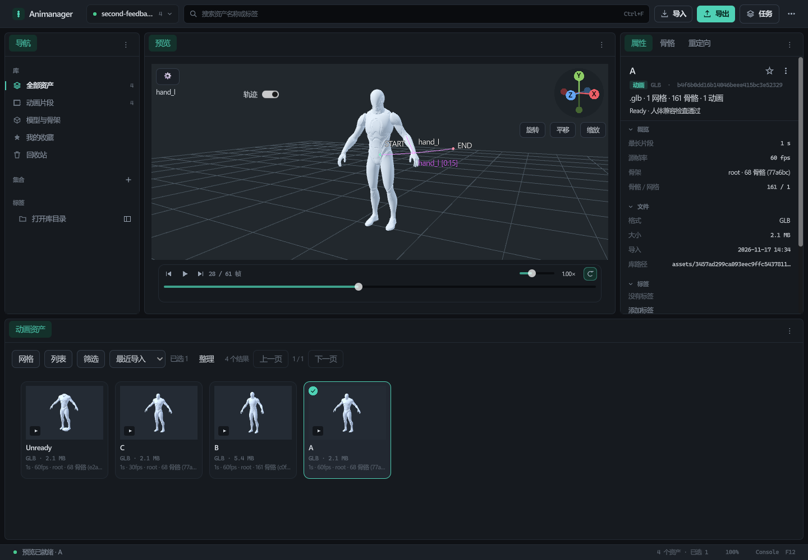
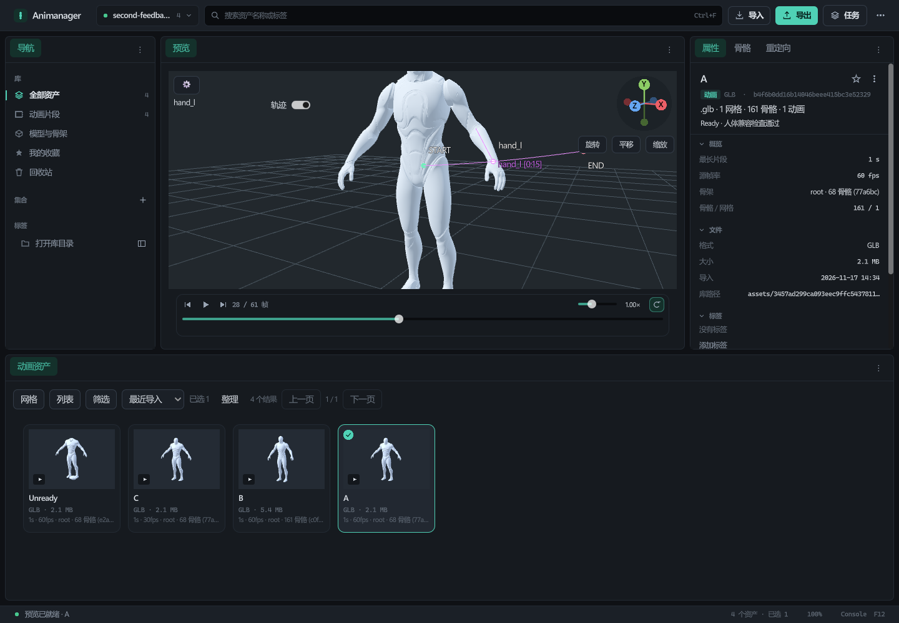
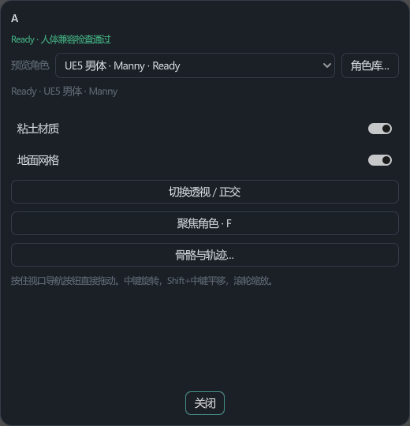
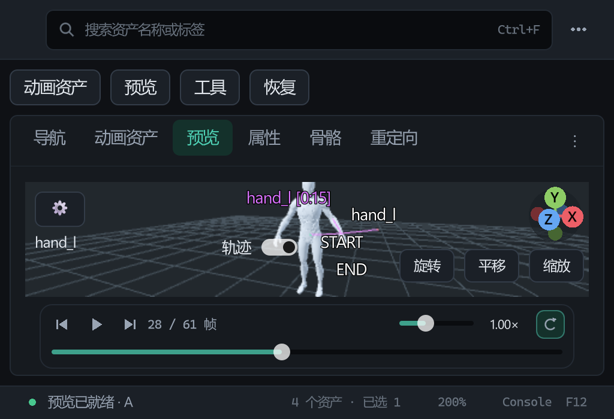

# 第二轮反馈验收 · 2026-11-17

Godot 4.7.2 Mono / .NET 8。构建零警告、零错误；所有运行均使用隔离测试库。

## 行为

1. 骨骼与轨迹文字从 `Label3D` 改为窗口二维标注，字号固定为 13 逻辑像素；跟随界面 DPI 清晰绘制，不受相机距离或 3D 渲染纹理缩放影响。相邻标注避让，并避开导航按钮。
2. 选中骨骼后，视口左上显示骨骼名和“轨迹”开关。与骨骼面板、Console 共用同一轨迹状态；多选、固定轨迹及 Root Motion 保持原有行为。
3. 旋转、平移、缩放按钮按下即开始拖动，松手结束；不再设置持久的左键操作模式。坐标轴保留拖动旋转和点击轴向切换。
4. 删除预览内容区上方固定标题、状态和选角区域。左上齿轮打开视口设置，容纳角色、角色库、粘土材质、网格、投影、聚焦和骨骼入口。播放控件保持底部两行布局。
5. 先在不可见场景中准备源资产和重定向结果，再一次性替换显示。切换期间保留当前画面；过期请求、取消和失败均不替换。新资产从自身首帧开始，帧数使用源 FPS；Console 和资产浏览器共用加载路径。

## 验证

| 套件 | 通过项数 | 日志 |
| --- | ---: | --- |
| 第二轮专项 | 21 | `.runtime/second-feedback-verified.log` |
| 骨骼界面 | 42 | `.runtime/second-bone-ui-test-output.log` |
| 多骨骼、固定轨迹与 Root Motion | 63 | `.runtime/second-multi-bone-test-output.log` |
| 多骨骼界面 | 49 | `.runtime/second-multi-bone-ui-test-output.log` |
| 角色库、切换、缓存与导出 | 32 | `.runtime/second-character-test-output.log` |
| 重定向、真实动作及 FBX 往返 | 75 | `.runtime/second-retarget-test-output.log` |
| 工作区、选择与缩放 | 64 | `.runtime/second-interface-test-output.log` |

合计 346 项。新增 21 项在图形和 headless 两种模式分别通过，不重复计数。专项用真实 GUI 鼠标事件验证按钮拖动，逐帧检查资产切换中没有源骨架闪现或空白，并验证从设置页选择 UE4 角色后实际显示 68 骨骼目标。

失败路径测试会主动输出预期错误；真实 MechanicGirl 样例仍有外部纹理缺失的导入日志，与本轮视口修改无关。未新增自动绑骨、自动蒙皮或接触 IK。

## 实际画面

远视图与近视图：相机距离变化，文字字号保持一致。

独立视口设置：

1024×700 物理窗口、200% 界面缩放：

