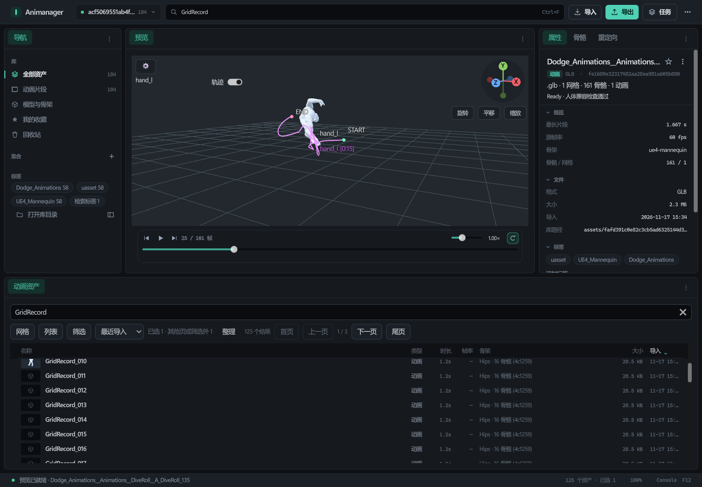
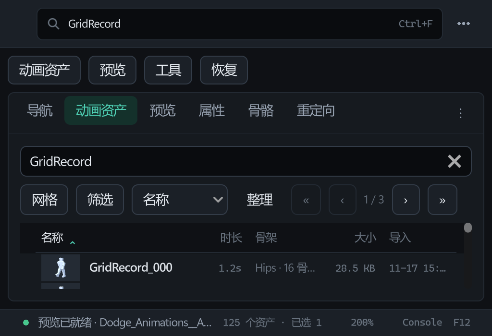
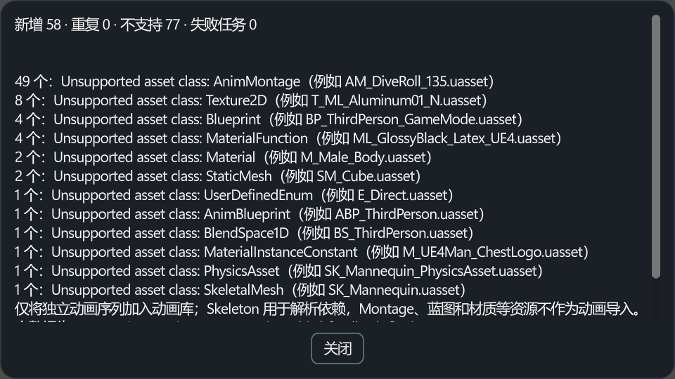
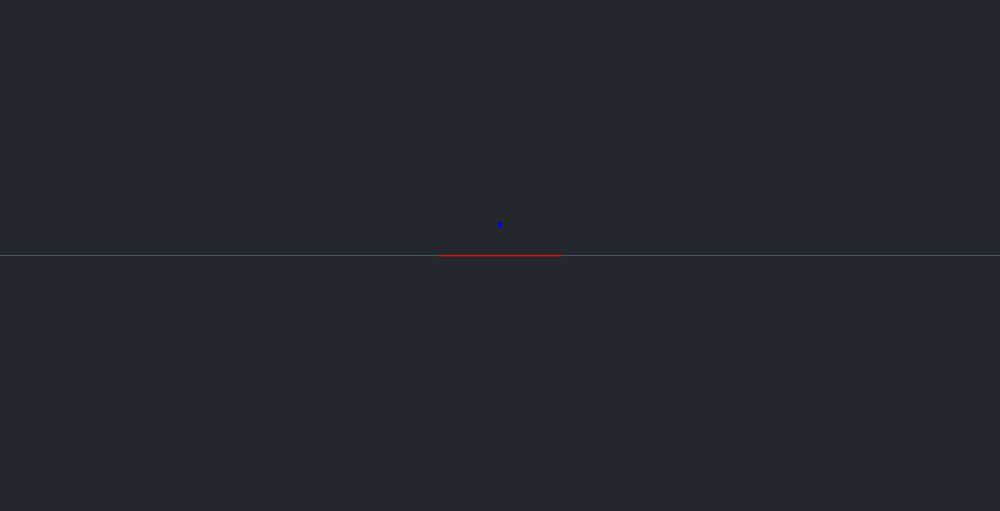
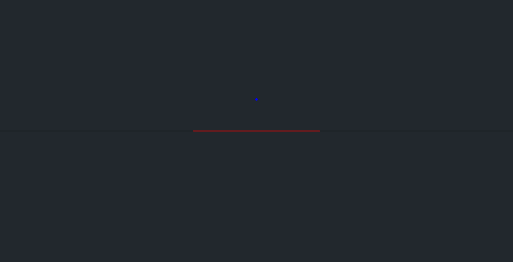

# 第三轮反馈验收 · 2026-11-17

Godot 4.7.2 Mono / .NET 8，Windows OpenGL Compatibility。应用构建零警告、零错误。CUE4Parse 导入器已重新发布到本地运行目录；使用已有依赖构建，NuGet 漏洞源网络不可达产生 NU1900 提示，构建成功。

## 修改

- 列表表头固定在滚动区顶部，排序点击区域随表头同步；键盘定位的资产行保持在表头下方。
- 资产区提供搜索框，与顶部搜索同步。按名称／标签检索当前库及分类，支持中文，输入后 200ms 自动应用，回车立即搜索，Ctrl+F 聚焦。
- 增加首页／尾页，使用当前搜索和筛选结果的页数。翻页重置列表滚动，边界与空结果禁用相应按钮；200% 小窗口使用紧凑工具栏。
- 普通文件夹导入自动发现 uasset，保留输入根目录供 Skeleton 依赖解析。混合文件夹仍导入 GLB／FBX；坏文件不阻断其他项。导入开始显示任务面板，结束显示新增／重复／不支持／失败任务及报告位置。
- 增加 UE4.27 编辑器原始动画轨道支持。未验证的版本、编码和非序列资源继续明确报告。
- 轨迹、骨骼连线用投影后的固定屏幕线宽，起终点和当前点使用固定屏幕半径；保留世界／相对空间位置、穿透开关及深度遮挡。缩放只改变轨迹在屏幕上的位置与长度，不改变线宽或标记大小。

## Dodge_Animations 实际复现

输入：`C:\Users\Reed\Downloads\Dodge_Animations`。先前失败的原因包括普通目录扫描忽略 uasset，以及导入器版本白名单没有 UE4.27。

此目录包含 136 个 uasset，保存版本为 UE4.27.2：

| 资源 | 结果 |
| --- | --- |
| 58 个 AnimSequence | 全部成功入库，0 个失败 |
| 1 个 Skeleton | 用于解析骨架依赖 |
| 77 个其他资源 | 明确列为不支持，包含 49 个 Montage、纹理、蓝图等 |
| 再次导入同目录 | 58 个重复，新增 0 |

通过独立源采样器直接读取原始包，每段取首帧、四分之一、中间、四分之三和末帧；与应用实际加载后的骨骼局部位置、旋转、缩放比较，共 19,720 次。最大位置误差 `0.0000135014 m`，最大旋转误差 `0.055953°`；缩放对照通过。另验证 Dodge 动画可自动重定向到 UE5 Manny。

所有测试写入隔离库；原目录全部 uasset 的前后 SHA-256 一致，没有向用户当前资产库写入测试条目。

## 验证

| 套件 | 通过项数 | 日志 |
| --- | ---: | --- |
| 本轮图形专项及真实 Dodge 导入 | 28 | `.runtime/third-feedback-final-output.log` |
| 资产浏览、筛选与排序 | 29 | `.runtime/third-asset-browse-test-output.log` |
| 工作区与界面（最终布局） | 64 | `.runtime/final-interface-test-output.log` |
| 骨骼轨迹 | 55 | `.runtime/third-bone-test-output.log` |
| 多骨骼、固定轨迹及 Root Motion | 63 | `.runtime/third-multi-bone-test-output.log` |
| 批量任务、部分失败、取消与重试 | 28 | `.runtime/third-batch-test-output.log` |
| UE4.23／UE5.6 uasset 与 FBX 往返 | 15 | `.runtime/third-standard-uasset-final-output.log` |

合计 282 项，不重复计数复跑。基础专项另在 headless 模式通过。渲染检查直接测量红色线段和蓝色端点的像素范围：远／近距离均为 `(1, 6)` 个核心颜色像素，透视／正交和视口大小改变后保持一致；深度遮挡与穿透模式分别验证。几何目标线宽 2 个逻辑像素、端点半径 3.5 个逻辑像素，核心颜色计数不包括 MSAA 边缘。

`Test.ps1 -Suite ThirdFeedback` 运行基础专项。图形验收使用 `--third-feedback-test`；真实素材通过 `--uasset-feedback-source=<目录>` 与 `--uasset-feedback-reference=<sample-source 输出 JSON>` 显式提供。

屏幕线宽使用 Godot 的 `POSITION` 投影结果和 `VIEWPORT_SIZE`，实现依据：[Godot 4.7 Spatial shaders](https://docs.godotengine.org/en/4.7/tutorials/shaders/shader_reference/spatial_shader.html)。

## 截图

列表已滚动，表头保持顶部：

1024×700、200% 缩放：

真实导入结果：

固定像素线宽测量用的远／近视图：

